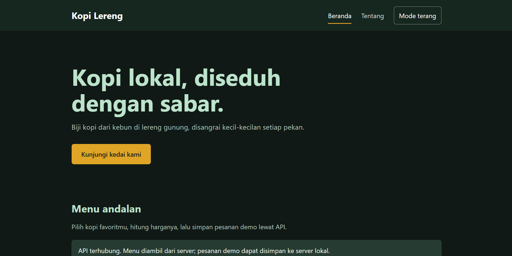
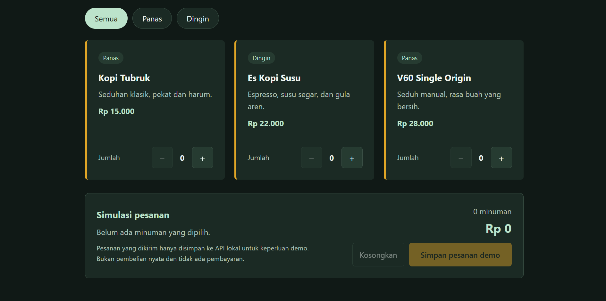
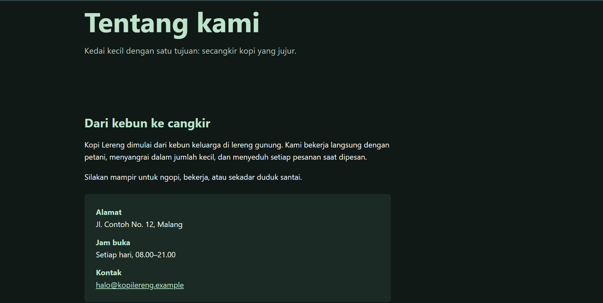
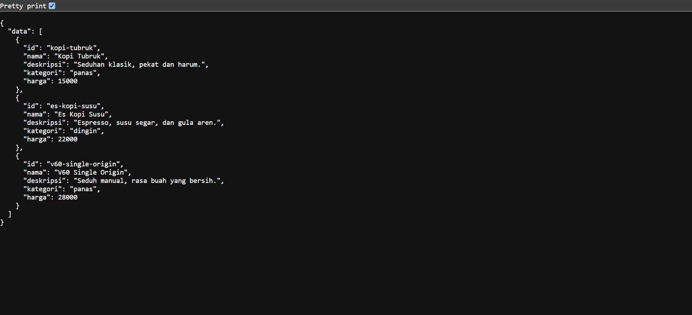

# Kopi Lereng — Website dan REST API JavaScript (Node.js)

Proyek **Kopi Lereng** merupakan website kedai kopi sederhana yang dibangun menggunakan HTML, CSS, dan JavaScript, serta dilengkapi REST API berbasis Node.js. Website menyediakan informasi menu kopi dan simulasi pemesanan demo yang mengirim data ke server lokal.

## Teknologi yang Digunakan

- **HTML** — membangun struktur halaman website.
- **CSS** — mengatur tampilan, tata letak, responsivitas, dan tema website.
- **JavaScript** — mengatur interaksi pengguna, filter menu, jumlah pesanan, perhitungan total, serta komunikasi dengan API menggunakan `fetch()`.
- **Node.js** — menjalankan server lokal dan REST API.
- **JSON** — menyimpan data menu dan data pesanan demo.

## Fitur Website

- Halaman beranda dan halaman Tentang Kami.
- Menampilkan daftar menu kopi dari server.
- Filter menu berdasarkan kategori panas dan dingin.
- Pengaturan jumlah minuman menggunakan tombol tambah dan kurang.
- Perhitungan jumlah minuman dan total harga.
- Pengiriman pesanan demo melalui REST API.
- Mode tampilan gelap dan terang.

## Dokumentasi Tampilan Website

Berikut adalah dokumentasi tampilan website Kopi Lereng dan bukti respons REST API.

### 1. Halaman Beranda

Tampilan halaman utama Kopi Lereng yang berisi navigasi, pengenalan kedai, dan bagian menu andalan.



### 2. Daftar Menu dan Simulasi Pemesanan

Tampilan daftar menu kopi, filter kategori, tombol pengaturan jumlah, serta ringkasan simulasi pesanan.



### 3. Halaman Tentang Kami

Halaman yang menampilkan informasi singkat mengenai Kopi Lereng, alamat, jam buka, dan kontak contoh.



### 4. Respons REST API Menu

Contoh respons JSON dari endpoint `GET /api/menu` yang menampilkan data menu kopi dari server.



## Persyaratan

- Node.js versi 18 atau lebih baru.
- Browser modern.
- Visual Studio Code (disarankan, tetapi tidak wajib).

Proyek ini tidak memerlukan instalasi paket npm tambahan.

## Cara Menjalankan Website dengan REST API

1. Ekstrak file ZIP.
2. Buka folder `Kopi_Lereng_JavaScript` di Visual Studio Code.
3. Pastikan Node.js versi 18 atau lebih baru sudah terpasang.
4. Buka menu **Terminal → New Terminal**.
5. Jalankan perintah berikut:

   ```bash
   node server.js
   ```

   Alternatifnya, jalankan:

   ```bash
   npm start
   ```

6. Buka browser dan kunjungi alamat:

   ```text
   http://localhost:3000
   ```

7. Pilih menu minuman dengan tombol `+` atau `−`, kemudian klik **Simpan pesanan demo** untuk mengirim pesanan ke API lokal.
8. Untuk menghentikan server, tekan `Ctrl + C` pada terminal.

> **Penting:** Jalankan `node server.js` agar endpoint API aktif. Membuka `index.html` secara langsung atau hanya menggunakan ekstensi Live Server tidak akan menjalankan REST API pada proyek ini.

## Mode Offline (Tanpa API)

File `index.html` dapat dibuka langsung di browser untuk melihat tampilan website, mengganti tema, menggunakan filter, dan mencoba simulasi perhitungan harga. Namun, fitur **Simpan pesanan demo** memerlukan server API yang sedang berjalan.

## Endpoint REST API

| Metode | Endpoint | Fungsi |
|---|---|---|
| `GET` | `/api/health` | Memeriksa status API. |
| `GET` | `/api/menu` | Mengambil seluruh data menu. |
| `GET` | `/api/menu?kategori=panas` | Mengambil menu kategori panas. |
| `GET` | `/api/menu?kategori=dingin` | Mengambil menu kategori dingin. |
| `GET` | `/api/menu/kopi-tubruk` | Mengambil detail menu berdasarkan ID. |
| `POST` | `/api/pesanan` | Mengirim dan menyimpan pesanan demo. |
| `GET` | `/api/pesanan/<id>` | Mengambil detail pesanan berdasarkan ID. |

### Contoh Body untuk POST `/api/pesanan`

Gunakan header `Content-Type: application/json` dengan body berikut:

```json
{
  "items": [
    { "id": "kopi-tubruk", "jumlah": 2 },
    { "id": "es-kopi-susu", "jumlah": 1 }
  ]
}
```

Harga dan total pesanan dihitung ulang di backend berdasarkan data pada `data/menu.json`. Pesanan demo dicatat ke `data/pesanan.jsonl`; file tersebut dibuat otomatis ketika pesanan pertama disimpan.

## Struktur Folder

```text
Kopi_Lereng_JavaScript/
├── index.html
├── tentang.html
├── style.css
├── script.js
├── server.js
├── package.json
├── README.md
├── PENJELASAN.txt
├── data/
│   └── menu.json
├── screenshots/
│   ├── 01-beranda.png
│   ├── 02-menu-dan-pemesanan.png
│   ├── 03-tentang-kami.png
│   └── 04-rest-api-menu.png
└── tests/
    └── api.test.js
```

File `data/pesanan.jsonl` akan dibuat otomatis oleh server setelah pesanan demo pertama disimpan.

## Menjalankan Pengujian API

Untuk menjalankan pengujian otomatis API, gunakan perintah:

```bash
npm test
```

## Batasan Proyek

- Proyek ini merupakan **demo lokal untuk pembelajaran**, bukan sistem transaksi produksi.
- Tidak tersedia pembayaran sungguhan, autentikasi pengguna, atau database SQL.
- Server secara default hanya mendengarkan pada `127.0.0.1` (komputer lokal).
- Informasi alamat dan kontak pada halaman Tentang Kami merupakan data contoh.
- Jangan mempublikasikan aplikasi ini sebagai sistem transaksi produksi tanpa menambahkan autentikasi, pembatasan permintaan, database, dan pengamanan lanjutan.
